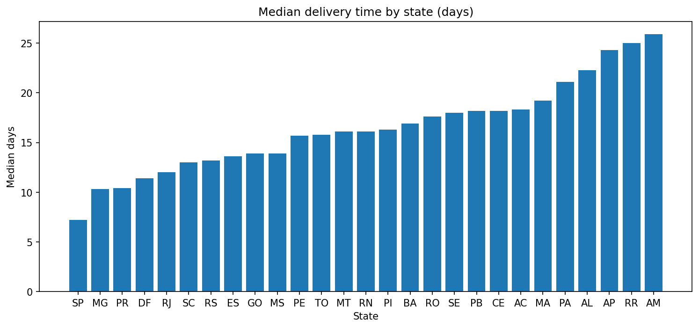
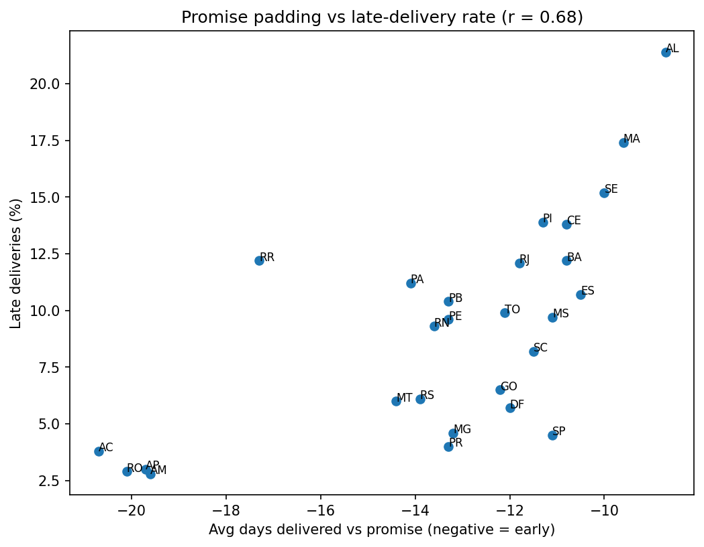

# Delivery-Speed Benchmarking — Olist E-Commerce (PySpark)

How fast do orders reach customers in each Brazilian state, and does the on-time rate tell the real story?
A delivery-speed benchmark built in PySpark on 99,441 real e-commerce orders.

## Data
[Brazilian E-Commerce Public Dataset by Olist](https://www.kaggle.com/datasets/olistbr/brazilian-ecommerce) (2016–2018). Orders joined to customer state.

## Pipeline
1. **Load & join** — orders joined to customer state in PySpark.
2. **Validate** — checks for missing state, undelivered orders, delivered orders with no delivery date, and deliveries timestamped before purchase.
   - 2,963 orders (2.98%) not delivered; 8 marked delivered with no delivery date.
   - **96,470 of 99,441 orders (97.0%) passed validation.**
3. **Metrics** — delivery days (purchase → delivery), late flag (delivered after promised date), days vs promise.
4. **Benchmark** — median delivery days, late %, and speed rank per state (window function), plus a Spark SQL view of the worst states for late delivery.
5. **Completeness check** — weekly state-level trend with a low-volume flag.
6. **Statistics** — chi-squared test, Welch t-test, Pearson correlation.

## Key findings
- **Speed gap:** São Paulo is fastest (median 7.2 days); Amazonas is slowest (25.9 days), a ~3.6× gap.
- **Late rates** range from 2.8% (AM) to 21.4% (AL). The difference is significant across the 12 largest states (chi-squared = 1418.4, dof = 11, p < 0.001).
- **Rio de Janeiro underperforms its size:** the second-largest market (12,350 orders) has a 12.1% late rate vs 4.5% for São Paulo, and a mean delivery time of 15.3 vs 8.8 days (Welch t-test, p < 0.001).
- **Promise padding hides slowness.** Every state's orders arrive before the promised date on average. The slowest states (AM, AP, AC) have the lowest late rates because their promises are padded by ~20 days, while AL and MA get ~9 days of padding and show the highest late rates. Less padding correlates with higher late rates (r = 0.68, p < 0.001, n = 27 states). **On-time rate alone would rank Amazonas as a strong performer; it is the slowest state in the country.**
- **Weekly data is thin:** 1,546 of 2,152 state-weeks (72%) have fewer than 30 orders, so state-level weekly reporting is unreliable for most states. Monthly or regional aggregation is needed.

## Caveats
- This benchmarks regions within one marketplace, not competitors.
- "Late" compares calendar dates.
- Medians are used because delivery times are right-skewed (RJ: median 12.0 vs mean 15.3 days).
- The correlation covers 27 state-level points and does not establish causation.
- The data is from 2016–2018 and demonstrates method, not current performance.

## Stack
PySpark · Spark SQL · pandas · SciPy · matplotlib · Google Colab
